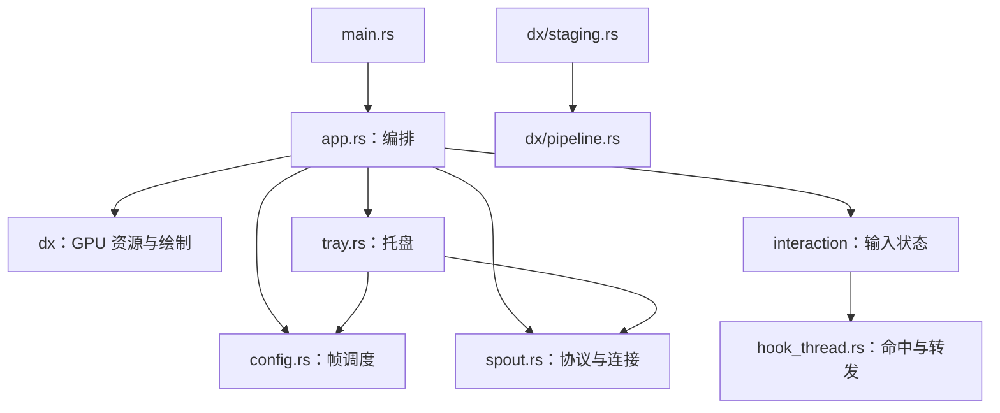
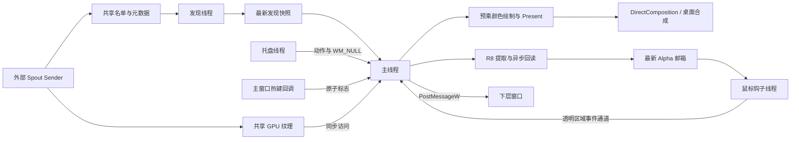

# 代码流程、结构与模块深度分析

分析日期：2026-10-10。对象为当前工作区，包括上一轮尚未提交的性能优化。
后续状态（2026-10-11）：稳定自动裁切已实现；下文 A 的 KeyedMutex 精确返回状态判断和 B 的资源代次就绪判断
已修复并验证。本文其余流程与行号记录对应分析当时的快照，当前代码请结合 README 与 PERFORMANCE.md 阅读。
同日后续：事件＋独立期限架构已实施，绘制拆入 Renderer，来源重试拆入 SourceController，
窗口与消息迁移至 ApplicationHandler；C 的帧预算叠加、E 的安装错误处理和 F 的鼠标事件唤醒已修复。
第 12 节保留原设计建议，实际实现与验证见 PERFORMANCE.md 的架构实施记录。
本轮对所有 15 个 Rust 文件进行了流程审查，并用独立 D3D11 探针核实关键现象；未修改业务代码。
证据分为实际复现、可由代码确定的行为，以及需要真实 Sender/驱动环境验证的风险。

整体设计适合单窗口 Spout 接收工具：GPU Immediate Context 由主线程使用，发现、托盘菜单和鼠标钩子分开运行。
主要问题集中在共享纹理同步、资源失效边界和主循环状态的一致性，而不是模块数量不足。

## 1. 模块职责与依赖

当前源码约 4,345 行，包含测试、诊断代码和空行。行数不等同于复杂度，但能定位职责聚集。

| 文件/模块 | 行数 | 实际职责 | 边界评价 |
| --- | ---: | --- | --- |
| `main.rs` | 42 | 日志初始化、Debug 控制台、调用入口、致命错误退出 | 清晰 |
| `app.rs` | 1,114 | COM、窗口、DComp、Sender/交换链资源、主循环、绘制、Alpha 发布、位图诊断、GPU 测试 | 职责最集中 |
| `config.rs` | 263 | 帧率枚举、限帧与唤醒调度、相关测试 | 实际是调度模块，文件名略宽泛 |
| `spout.rs` | 669 | 协议解析、命名句柄、共享内存、发现线程、选择策略、元数据状态、帧计数 | 协议与连接策略混在一起 |
| `tray.rs` | 610 | 隐藏任务栏、托盘线程、菜单构建、菜单快照、动作传递 | 功能集中但使用全局状态 |
| `interaction/mod.rs` | 548 | 配置解析、全局热键、窗口样式、拖动、缩放、Alpha 调度、钩子管理 | 输入配置与交互状态可进一步分开 |
| `interaction/hook_thread.rs` | 507 | 鼠标钩子线程、掩码邮箱、双线性采样、透明点击转发 | 核心逻辑较完整，输入语义有边界 |
| `dx/` | 592 | 设备、DComp、交换链、着色器、同步 guard、R8 回读、旧像素工具 | 大部分资源组件边界清晰 |

入口与模块的依赖关系：



`tray` 依赖 `SenderName` 和 `FrameRate` 是共享数据类型的依赖，没有直接进入 GPU 操作。
`staging` 依赖 `Pipeline` 以复用着色器和采样状态，也合理。`app` 同时持有各模块状态，承担所有跨模块决策。

## 2. 启动流程

入口位于 [main.rs:33](/C:/Users/19825/Desktop/CodexProject/spout-transparent/src/main.rs:33)，主要编排位于
[app.rs:477](/C:/Users/19825/Desktop/CodexProject/spout-transparent/src/app.rs:477)。

1. 创建 Debug 控制台并初始化日志。
2. `init_app()` 初始化 COM，创建 D3D11 设备和 Immediate Context；优先硬件设备，失败后尝试 WARP。
3. 初始化 `SpoutReceiver`，编译三个 HLSL 着色器，创建采样器与光栅状态。
4. 启动 Sender 发现线程。
5. 创建 1×1 透明无边框窗口并隐藏，取得 HWND，设置窗口扩展样式。
6. 启动托盘线程，加载 `hotkeys.json` 或默认热键，安装热键子类过程。
7. 创建 DComp Device、Target、Root Visual 和 Scale Transform。
8. 启动鼠标钩子线程；初始化请求可见、实际可见和来源就绪状态。
9. 构造 `RenderState`，进入 winit 事件循环。

启动时不会立即创建完整尺寸的交换链；发现可打开的 Sender 后才创建。Alpha GPU 资源更晚，仅开启交互时创建。
着色器在启动时运行时编译，属于启动开销，不属于逐帧开销。

## 3. 四个应用线程与通信语义

以下不包括驱动、DWM 或库内部线程。

| 线程 | 主要任务 | 接收/发送方式 | 等待方式 |
| --- | --- | --- | --- |
| 主线程 | winit、资源重建、共享纹理读取、DComp、呈现、交互状态 | 消费发现快照、托盘动作、热键标志、鼠标事件；发布 Alpha | `WaitUntil` 或 `Poll`，也可能在 `Present`/系统调用中等待 |
| `spout-discovery` | 读取名单、验证 Sender 元数据 | `Arc<Mutex<Option<Result<Vec<SenderName>>>>>`，保留最新快照 | 每次扫描后等待 500 ms，可由停止通道提前结束 |
| `spout-tray` | 托盘消息与菜单跟踪 | 原子状态、来源快照、单个待处理命令；`WM_NULL` 唤醒主窗口 | `GetMessageW`，菜单打开时进入菜单跟踪 |
| `mouse_hook` | 全局鼠标钩子、按 Alpha 判定透明区域 | 命令通道、掩码邮箱、回传事件通道；`WM_HOOK_COMMAND` 唤醒自身 | `GetMessageW` |

这里有一个重要差别：发现结果和 Alpha 掩码适合“只保留最新值”；用户动作通常需要保留顺序。
托盘命令的 `AtomicU32` 和热键的 `AtomicBool` 都可能合并尚未消费的连续动作，而鼠标事件使用 FIFO 通道。



当前 GPU Context 没有跨应用线程并发使用，这降低了 D3D11 调用同步的复杂度。
主线程仍会短暂获取邮箱/名单互斥锁；“后台发现”不等同于主线程完全没有锁或系统调用。

## 4. 主循环一轮究竟执行什么

`WindowEvent` 处理退出、修饰键、滚轮、鼠标按钮和光标移动；主要工作在
[AboutToWait 分支](/C:/Users/19825/Desktop/CodexProject/spout-transparent/src/app.rs:635)。

每轮按以下顺序执行：

1. 排空鼠标穿透事件并转发给下层窗口。
2. 消费退出、交互、置顶、帧率热键请求。
3. 消费一个托盘动作。
4. 获取最新发现结果，更新 Receiver 的候选来源和托盘快照。
5. `SpoutReceiver::poll()` 更新连接元数据；未到轮询时间时返回缓存状态。
6. 取得 Sender 名称、共享句柄和资源 `generation`。
7. 检查资源变化和 500 ms 失败重试冷却；需要时重新打开 Sender 并创建交换链。
8. 更新来源就绪、窗口实际可见和托盘状态。
9. 应用缩放变更，管理 Alpha 回读资源，尝试读取上次提取的 Alpha。
10. 满足可见、有元数据、限帧到期时，尝试纹理同步锁。
11. 持锁后查询帧计数。新帧或显式重绘才 Draw；交互开启且非拖动时，按 100 ms 间隔安排 Alpha 提取。
12. 离开纹理锁作用域后，对已绘制帧调用 `Present(1, ...)`。
13. 在 `Present` 返回后记录时间，计算下一次唤醒。

循环次数、Draw 次数和呈现次数是三个不同的量。`frame_count` 实际累计主循环轮次，不能用作接收 FPS。
Alpha 读取也不要求当前轮有新帧：它消费的是已经入队的本地 staging 纹理。

## 5. Sender 状态与资源状态

连接状态位于 [spout.rs:187](/C:/Users/19825/Desktop/CodexProject/spout-transparent/src/spout.rs:187)。

| 状态/结果 | 当前行为 |
| --- | --- |
| 尚未选择来源 | 每 500 ms 尝试从发现列表选取可用来源 |
| 已连接 | 每 100 ms 重新打开并读取当前 Sender 元数据 |
| 元数据锁忙 | 保留当前信息，继续使用已有资源 |
| 元数据句柄无效或尺寸为零 | 清空当前元数据，降低至 500 ms 轮询 |
| 当前映射不存在 | 清空当前元数据并尝试自动选择其他来源 |
| 名称、句柄、尺寸、格式、usage 或 partner_id 变化 | 更新资源代次，主循环尝试重建 |
| 用户手动选择来源 | 清空当前元数据，使下一次查询立即执行 |

`selected` 表示查询对象，`current` 表示最近一次可用元数据；它们并不等同于成功打开的 GPU 资源。
手动选择也不是永久锁定：所选映射消失时，当前实现可能自动切换到其他来源。

主循环还维护 `current_handle/current_sender_name/current_sender_generation`，表示已安装的 GPU 资源身份。
窗口可见性又由 `window_requested_visible`、`window_visible`、`source_available` 三个变量协调。
这个模型能表达必要情况，但状态分散在 Receiver、RenderState 和闭包局部变量中，容易漏掉一致性条件。

## 6. 显示与 Alpha 数据路径

显示路径是共享纹理 → SRV → 全屏三角形 → BGRA 交换链 → DComp → 桌面。
片元着色器把 `RGB` 乘以 `A`，与交换链 `PREMULTIPLIED` Alpha 模式配合。
这意味着输入纹理按直通 Alpha 处理；已经预乘的输入会再次乘 Alpha，属于格式约定需要明确的兼容边界。

交换链尺寸保持 Sender 原始尺寸。滚轮缩放改变 DComp Transform 和窗口尺寸，避免按缩放后的面积重建渲染目标。
显示与 Alpha 提取都使用相同的全屏三角形及线性采样规则。

Alpha 路径位于 [staging.rs](/C:/Users/19825/Desktop/CodexProject/spout-transparent/src/dx/staging.rs:16)：

1. Alpha Pixel Shader 将共享纹理 Alpha 写入一个 R8 渲染目标。
2. CopyResource 复制至两个 R8 staging 槽位之一。
3. 队列满时跳过本次提取，避免无限堆积 GPU 工作。
4. 后续循环用 `DO_NOT_WAIT` 尝试 Map 队首；GPU 忙时保留队列，立即返回。
5. 按 RowPitch 逐行复制到 CPU Vec，忽略行对齐填充。
6. 转移 Vec 所有权至鼠标线程邮箱，并复用被替换或回收的 Vec。

鼠标钩子只检查按钮与滚轮，不检查每一个 MouseMove。它将窗口坐标映射回源 Alpha，进行双线性采样，
低于阈值 10 的区域被判为透明。事件随后由主线程用 `PostMessageW` 转发。
这是按最近 Alpha 样本判定，不是当前显示帧的同步命中检测；100 ms 采样周期还会叠加回读和事件等待。
拖动期间暂停新 Alpha 提取，但已入队结果仍可被读出。

## 7. 已确认的问题与优先级

### A. P1：KeyedMutex 超时被当作已取得锁——实际 D3D11 复现

位置：[keyed_mutex.rs:11](/C:/Users/19825/Desktop/CodexProject/spout-transparent/src/dx/keyed_mutex.rs:11)。

当前代码用 `mutex.AcquireSync(0, 0).is_ok()` 判断拥有纹理。锁的原始 API 返回 HRESULT，
其中 `WAIT_TIMEOUT=0x102` 和 `WAIT_ABANDONED=0x80` 都是非负值。
本项目锁定的 `windows 0.58` 包装内部调用 `.ok()`，把这些状态转换成 `Ok(())`，丢失原始状态。
微软明确要求对 AcquireSync 的返回状态进行显式判断，不能仅判断 HRESULT 成功位。
见 [AcquireSync 文档](https://learn.microsoft.com/en-us/windows/win32/api/dxgi/nf-dxgi-idxgikeyedmutex-acquiresync)。

本地探针创建一个真实 keyed texture，先取得 key 0，再释放为 key 7，然后尝试取得 key 0：

```text
KEYED_MUTEX raw_hresult=0x00000102, wrapper_is_ok=true, guard_created=true
```

原始 API 已超时，但生产 `KeyedMutexGuard::try_acquire` 仍返回 Some。后续会读共享纹理，并在 Drop 中释放
实际上未取得的锁。具体画面异常取决于 Sender 和驱动，但错误的所有权判断已复现。
`WAIT_ABANDONED` 的误判依据包装语义确定，未单独制造设备失效场景复现。

建议：通过一个隔离的底层调用保留原始 HRESULT，仅 `S_OK` 创建 guard；超时返回 Busy，
abandoned 返回资源失效事件触发重建。不要再用同一个 `Result<()>` 包装判断精确状态。

### B. P2：资源就绪判断遗漏 generation——代码路径确定

重建条件检查 generation，位置 [app.rs:742](/C:/Users/19825/Desktop/CodexProject/spout-transparent/src/app.rs:742)；
但 [source_ready 判断](/C:/Users/19825/Desktop/CodexProject/spout-transparent/src/app.rs:794) 仅检查名称和句柄。

如果同名 Sender 重建纹理时复用了句柄，元数据代次已经变更，而资源打开或交换链创建失败，旧 GPU 资源仍留在 RenderState。
由于名称与句柄仍相等，`source_ready` 可以继续为 true；可见窗口仍可能读取旧资源。
这是失效状态与可显示状态混淆。尚未用真实 Sender 制造句柄复用和创建失败。

建议：就绪身份统一为 `SenderIdentity { name, handle, generation }`，与已安装资源身份整体比较。
如果希望在重建失败时保留最后一帧，应明确区分“旧画面可展示”和“当前来源可读取”，避免继续读取失效代次。

### C. P2：限帧预算从 Present 完成时开始——时间模型复现

位置：[app.rs:955](/C:/Users/19825/Desktop/CodexProject/spout-transparent/src/app.rs:955)、
[config.rs:97](/C:/Users/19825/Desktop/CodexProject/spout-transparent/src/config.rs:97)。

每次 Present 返回后才记录 `last_presented_at`，下一帧又完整等待 16.667 ms/33.333 ms 等预算。
帧起点间隔因此包含绘制和 Present 调用耗时，再加完整限帧间隔，限帧模式容易低于所选上限。
Present(1) 还保留垂直同步；调用耗时与刷新率、队列和驱动有关。
见 [Present 文档](https://learn.microsoft.com/en-us/windows/win32/api/dxgi/nf-dxgi-idxgiswapchain-present)。

探针调用真实 FramePacer，以逻辑时间模拟一帧在起点后 10 ms 完成，目标为 60 FPS：

```text
PACING due_at_start_plus_16_667ms=false, next_start_ms=26.667
```

这证明调度预算叠加，不能据此宣称某台设备实际会降为固定 FPS。
建议：定义帧起点/提交期限并计算剩余预算，或使用绝对 deadline；结合实际 Present 耗时验证。
不要直接把 Present 的同步间隔改为 0 来掩盖计时问题。

### D. P2：关闭交互不保证立即释放全部 Alpha 内存——引用持有复现

位置：[app.rs:67](/C:/Users/19825/Desktop/CodexProject/spout-transparent/src/app.rs:67)、
[staging.rs:94](/C:/Users/19825/Desktop/CodexProject/spout-transparent/src/dx/staging.rs:94)、
[hook_thread.rs:209](/C:/Users/19825/Desktop/CodexProject/spout-transparent/src/interaction/hook_thread.rs:209)。

`alpha_readback=None` 会释放对象持有的引用，但 D3D11 Context 也持有绑定 RTV 的引用。
探针在 enqueue 后 Drop AlphaReadback，查询 Context 仍能取得 RTV：

```text
LIFETIME alpha_target_still_bound_after_owner_drop=true
```

这与 [OMSetRenderTargets 文档](https://learn.microsoft.com/en-us/windows/win32/api/d3d11/nf-d3d11-id3d11devicecontext-omsetrendertargets)
说明的引用持有行为一致。如果 Sender 静止且没有后续 Draw 替换目标，R8 目标可能继续存活。
CPU 侧的 `rs.alpha_buf`、钩子当前 `mask_alpha` 和邮箱回收缓冲也没有在 SetEnabled(false) 时清空。

这些是有界的资源保留，不能称为无限内存泄漏。PERFORMANCE.md 中交互关闭后的 `8*N` 模型是理想
应用自持 GPU 纹理模型，不代表关闭瞬间的完整实际占用，也没有计算 CPU Alpha 缓冲。
建议：在失效边界解除相关 RTV/SRV 绑定；明确立即释放还是保留以快速重启的策略。
停止资源使用后，必要时按生命周期处理延迟销毁，不应每帧无条件 Flush。

### E. P2：DComp 安装失败后仍标记资源重建成功——错误处理路径确定

位置：[app.rs:770](/C:/Users/19825/Desktop/CodexProject/spout-transparent/src/app.rs:770)。

资源替换阶段忽略 SetScale、SetContent 和 Commit 返回结果，随后更新全部资源身份并记录“重建完成”。
如果 SetContent/Commit 失败，Renderer 与 DComp 内容可能不一致，后续身份判断也不会再次触发相同重建。
相比之下，普通缩放路径已经检查 Commit 错误，两个路径的处理方式不一致。

建议：新资源的创建、DComp 安装与状态提交使用一个可失败的流程；最后一步成功后再更新已安装身份。
需要回滚的 DComp 变更也必须纳入处理。此问题未进行故障注入。

### F. P2：透明点击事件没有主动唤醒主循环——代码路径确定

钩子 [发送 PassthroughEvent](/C:/Users/19825/Desktop/CodexProject/spout-transparent/src/interaction/hook_thread.rs:344)
后直接吞掉原始事件。事件通道自身不会唤醒 winit；主线程等到下一轮 AboutToWait 才读取。
托盘动作有 WM_NULL 唤醒，这条鼠标路径没有。

在限帧 30 FPS 且没有其他消息时，转发可能等待当前帧 deadline 的剩余部分；还可能受 Present 阻塞影响。
因此不宜把上一轮的“8 ms 静止轮询上限”理解为完整点击转发延迟上限。
建议：发布事件后使用 EventLoopProxy 或一个明确的 Win32 唤醒消息；只通知，不在钩子回调中同步调用主线程。

## 8. 需要专项验证的风险与行为边界

这些项目与上面的实际复现不同，不宣称已观察到现场故障。

| 项目 | 代码依据与影响 | 建议验证 |
| --- | --- | --- |
| 命名纹理锁的 GPU 提交时序 | 主循环中 named guard 在 Present 之前释放；Draw 返回不等于 GPU 完成读取 | 双设备/双进程高帧率 Sender、GPU 队列拥堵时检查读写竞争与帧一致性 |
| 跨适配器来源 | 设备只尝试默认硬件适配器与 WARP；没有按 Sender 枚举/选择 GPU | 核显与独显来源分别测试，提供明确适配器诊断 |
| 单槽命令合并 | 托盘 AtomicU32、热键 AtomicBool 合并连续未消费操作 | 主线程繁忙时连续切换交互/置顶，决定动作是否必须 FIFO |
| 透明点击转发语义 | PostMessage 携带的是鼠标消息，不是完整原生输入流程；wParam 仅保存有限按钮状态 | Ctrl/Shift 点击、组合按钮、双击、鼠标捕获、窗口激活与跨完整性级别目标 |
| 缩放边缘命中 | 代码按最终窗口整数尺寸采样，而 DComp 使用浮点缩放系数，两者有取整差异 | 0.1×、非整数缩放、不同 DPI、细小透明边缘 |
| 线程退出时长 | Drop 调用 join；名单锁等待上限 67 ms，但整轮扫描还包含多次系统调用 | 多 Sender、菜单打开、消息发送失败时退出测试；67 ms 不是整个退出流程的硬上限 |

关于命名锁时序：Spout 的参考接收实现会在复制命令之后、释放访问权之前 Flush；本项目直接在共享 SRV
上绘制，并采用不同提交路径，因此存在需要核对的差异。这是根据代码和 API 语义作出的风险推断，
不是已证实的画面撕裂。参考 [SpoutDX 接收实现](https://github.com/leadedge/Spout2/blob/master/SPOUTSDK/SpoutDirectX/SpoutDX/SpoutDX.cpp)。
[Flush 文档](https://learn.microsoft.com/en-us/windows/win32/api/d3d11/nf-d3d11-id3d11devicecontext-flush)
说明它提交队列但不保证 GPU 已完成；因此“简单加 Flush”也不能自动证明所有并发时序正确。

## 9. 资源与异常处理评价

已做得较好的部分：

- SharedMap 的 view、mapping 和 NamedMutex 都有 Drop；创建失败路径也释放已经创建的映射。
- NamedMutexGuard 在作用域结束释放 OS mutex，并处理 WAIT_ABANDONED 对普通命名锁的所有权语义。
- SenderDiscovery 使用可唤醒停止通道，避免退出时固定再睡满 500 ms。
- Alpha 邮箱采用最新值替换和 Vec 复用；回读槽位固定为两个，避免队列无界增长。
- 托盘菜单先复制来源快照，再以该快照解析命令，避免名单刷新导致选择错位。
- 鼠标事件转发采用异步 PostMessage，避免同步进入下层窗口过程。
- Sender 重建会取消拖动并使 Alpha 掩码失效；窗口隐藏与禁用交互会取消拖动。

尚需统一的部分：

- 连接元数据、GPU 身份、合成内容和 Alpha 掩码应共享一个明确的资源代次。
- Sender 消失只隐藏窗口，RenderState 和 DComp 仍可能保留上一个 Sender 的资源；这是保留策略，
  不等同于已释放资源。长期无来源时可以提供延迟释放策略。
- Present 错误直接退出，不区分设备移除/重置后的恢复；OpenSharedResource 错误则每 500 ms 重试。
- Alpha 创建失败没有单独冷却，会在后续主循环继续创建和记录警告，应按资源代次限频。
- COM guard、窗口子类、热键和线程对象的退出次序依赖局部变量及闭包生命周期；应让资源拥有者的
  Drop/显式 shutdown 约束这一步，而不是只在几个退出分支手工 cleanup。

## 10. 推荐的结构调整

第一阶段保持线程布局，先让状态边界清楚；仅为了拆文件而增加线程，会引入更多 Context、窗口和同步问题。

建议的职责布局：

```text
src/
  main.rs                   入口
  app.rs                    ApplicationHandler / App 编排
  app_state.rs              可见性、来源状态、动作归约
  frame_pacer.rs            帧起点、deadline、空闲退避
  renderer/
    mod.rs                  Renderer、render/present、安装/释放来源
    sender_resources.rs     已打开资源和完整 SenderIdentity
    alpha.rs                回读调度、发布、失效与内存策略
  spout/
    protocol.rs             字节布局、原始名称、字段验证
    shared_map.rs           映射与命名句柄 RAII
    discovery.rs            发现线程与最新快照
    receiver.rs             选择、连接、代次与重连策略
  interaction/
    mod.rs                  拖动、缩放和交互状态
    hotkeys.rs              配置、注册和热键动作
    hook_thread.rs          钩子、邮箱和透明命中
  dx/                       保留现有设备/交换链/合成/流水线组件
  diagnostics.rs            位图保存、像素采样和运行指标
  tray.rs                   托盘 UI 与动作发布
```

这不是要求立即创建所有文件，而是职责目标。优先抽取 Renderer 和 SourceController，使主循环依次执行
“处理动作 → 更新来源 → 同步显示状态 → 尝试渲染 → 安排唤醒”。

建议状态模型用 `Waiting`、`Opening`、`Ready(identity)`、`Retrying(identity, deadline)` 表达来源阶段，
将身份和资源组成一个不可分割的值。缩放、交互、帧率和置顶属于用户状态；已显示帧属于显示状态。
它们不应因为缓存元数据可用就自动获得“当前资源可读”的资格。

对不同跨线程数据选择不同通道：发现和 Alpha 保留最新快照；Quit 独立可靠传递；需要顺序的
Toggle/SelectSource 用动作队列，SetFrameRate 等可覆盖状态由明确策略决定。

一些清理可以随后完成：`handle_keyboard` 当前没有有效动作，`modifiers` 只被写入；
`dx/constants.rs` 留有被 allow(dead_code) 隐藏的旧 CPU 像素工具。清理它们有助于阅读，但不是主要运行加速来源。
把 Debug 诊断与 GPU 测试从 app.rs 移出，也能减少主流程阅读负担。

## 11. 验证状态与实施顺序

上一轮已运行 30 项测试（含默认忽略的 D3D11 像素测试），以及格式检查、严格 Clippy 和 Release 构建。
本轮复用实际生产模块建立独立探针，确认 keyed timeout 误判、限帧时间模型和 Alpha RTV 引用保留。
本轮探针在 `target/code_flow_probe.rs`，输出程序在 `target/code_flow_probe.exe`，属于忽略的临时验证产物。

现有测试覆盖协议解析、帧计数、调度、缩放、掩码邮箱、菜单快照、像素渲染与 Alpha 回读；
尚不能证明同名重启、句柄复用、真实锁争用、DComp 安装失败、多 GPU 和输入穿透的端到端正确性。

推荐顺序：

1. 修复精确锁状态判断，并增加真实 timeout 和 abandoned 状态处理验证。
2. 统一资源身份与就绪条件，纳入 DComp 安装成功，验证重建失败后的行为。
3. 调整帧 deadline 与鼠标事件唤醒，采集 Present 耗时、Draw 次数和实际呈现 FPS。
4. 明确关闭交互/长期无来源时的 GPU 解绑与 CPU 缓冲保留策略。
5. 在上述边界有测试后抽取 Renderer、SourceController、Hotkeys 和 Diagnostics。

需要保留的运行指标包括：主循环唤醒次数、Draw/Present 次数、锁忙次数、共享资源打开失败次数、
Present 耗时、Alpha Map 命中率/队列深度、掩码样本年龄、进程 CPU 时间与私有内存。
GPU 显存及真实呈现延迟需要相应 GPU/呈现采样，不能用纹理字节公式或普通单元测试替代。

## 12. 模块间调度的进一步调整方案

以下为设计建议，尚未实施。第一阶段可以保留目前四个应用线程，先改变任务触发方式和状态归属。
收益应分别用输入延迟、连接发现时间、唤醒次数和实际呈现间隔验证。

### 12.1 用统一事件入口处理动作，保留必要的轮询

主事件循环改为 `EventLoop<AppEvent>`，后台线程通过 `EventLoopProxy` 通知主线程。
该机制已经存在于项目锁定的 winit 0.30.13，见 [EventLoopProxy 文档](https://docs.rs/winit/0.30.13/winit/event_loop/struct.EventLoopProxy.html)。

| 事件来源 | 推荐传递方式 | 消费规则 |
| --- | --- | --- |
| 退出 | 独立可靠事件/标志加唤醒 | 优先处理 |
| 托盘与热键动作 | 带完整参数的有序动作 | Toggle 不丢、不被后一个动作覆盖；SelectSource 不再拆成 command/source 两个槽位 |
| 鼠标穿透按钮和滚轮 | 有序事件通道加主循环唤醒 | 保持事件顺序，不能为了限帧而延后处理 |
| 发现结果 | 最新名单快照加变化通知 | 正常名单未变化时不通知；选择后可强制请求一次发现 |
| Alpha 掩码 | 最新样本邮箱 | 允许旧样本被替换，携带来源身份与样本时间 |

窗口热键回调可继续保留一个轻量入口，由主线程归约为同一种 AppAction；无需强行迁移到后台线程。
无需把整张 Alpha 图像放进 winit 事件，只发送通知并转移邮箱内 Vec 所有权。
发现线程仍定时扫描：Spout 共享名单不会自动触发 winit 事件。

快照通知可合并，但必须处理通知与新数据同时到达的竞态：消费中发布的新版本不能因清除通知标志而永远无人处理。
对于数量较少的用户动作，先直接发送逐个事件比设计复杂的通知合并更易验证。

### 12.2 主循环按职责划分事件阶段与渲染阶段

推荐流程为：

```text
UserEvent / WindowEvent
  → 处理退出与有序输入动作
  → 更新 AppState，标记需要执行的任务

定时到期
  → 只执行到期的元数据查询、重连或回读尝试
  → 计算是否具备绘制条件
  → 合并 request_redraw

RedrawRequested
  → 复核来源身份、可见性、帧率许可和 GPU 资源
  → 尝试纹理锁，绘制/提取，呈现
  → 对成功的帧确认完成；失败保留 dirty 状态

AboutToWait
  → 只协调剩余待办任务和下一次唤醒期限
```

winit 的 ApplicationHandler 文档建议使用 RedrawRequested 驱动绘制，因为 AboutToWait 的频率会受高频输入影响。
见 [ApplicationHandler 文档](https://docs.rs/winit/0.30.13/winit/application/trait.ApplicationHandler.html)。
request_redraw 只是安排工作，绘制处理阶段仍要复核条件，不能假设所有 RedrawRequested 都由内部帧调度发起。

### 12.3 一个协调器，多个独立 deadline

建议 `Scheduler` 只管理时序，不执行 Win32/D3D11 操作；各模块返回本次结果与下次必要期限。

| 任务 | 生效条件 | 时序策略 |
| --- | --- | --- |
| 已连接元数据查询 | 有查询中的 Sender | 首阶段保留 100 ms 间隔 |
| 来源发现 | 发现线程运行 | 首阶段保留 500 ms 扫描；UI 由变化事件唤醒 |
| 资源重建 | identity 不匹配或资源失效 | 新身份立即尝试；同身份失败按重试 deadline |
| 新帧探测 | 可见且来源就绪 | 帧计数 Sender 使用有上限退避；无计数 Sender 保留接收节奏 |
| 显示帧 | 有待显示更新且来源就绪 | 同时满足帧率期限、锁许可与呈现容量 |
| Alpha 提取 | 交互开启、可见、非拖动、内容需要新掩码 | 首阶段保留 100 ms 采样间隔，首次有效掩码立即安排 |
| Alpha 回读 | 确有 pending 槽位且仍需要该结果 | 仅在 pending 时安排非阻塞检查 |
| 延迟释放 | 隐藏/无来源且达到保留期限 | 一次性任务，取消后不再产生唤醒 |

`next_wake` 是所有当前生效任务的最早期限；没有生效任务时用 `ControlFlow::Wait`。
例如隐藏窗口后取消新帧探测、显示和 Alpha 提取；pending 回读可明确选择丢弃，或只完成一次尾部任务。
元数据监控若仍留在主线程，则必须继续安排其期限，不能立即无限等待。
后续若把元数据监控也放到发现线程，无来源且没有重试/释放任务时，UI 才能完全等待事件。

帧提交时刻需要满足多个许可时，用相关许可期限的最大值；主循环何时需要醒来检查任务，才使用各任务期限的最小值。
无 pending 帧时不应把已经到期的帧率 deadline 留在唤醒集合，否则会重新形成空转。
任务失败后必须移动其重试期限，不能让过期 deadline 无限留在过去。

### 12.4 新帧检测和成功确认分离

当前 `FrameCounter::is_new_frame()` 会修改 last_count。如果把它提前到独立探测任务，必须保存探测结果，
不能在渲染前再查一次并丢掉之前发现的新帧。

建议保留 `pending_frame` 或 `observed_sequence`：发现新内容后标记 pending；纹理锁忙、呈现容量不足、
还未到帧率期限时继续保留；实际成功提交后才确认对应更新完成。
如果中间发生来源切换，按完整 identity 丢弃旧来源的 pending。
没有帧计数的兼容路径不能等待一个永远不会到来的 FrameAvailable 事件。

Spout 的帧计数信号量也不能直接当作“下一帧通知”阻塞等待：它通常保留累计的非零计数，
WaitForSingleObject 会立即返回，并且占用计数可能干扰协议。只有 Sender 明确支持且参与信号通知时，
才使用约定的帧同步事件；否则继续保留计数探测。

### 12.5 限帧以帧起点或绝对 deadline 为基准

目标间隔记为 P，上一帧开始/提交期限记为 T。下一帧目标应围绕 T+P，绘制和 Present 耗时计入同一个预算。
在 Present 返回时计算剩余时间，而不是再追加一个完整 P。
如果已经错过期限，跳过过期时间段并重新安排，避免追赶式连发大量旧帧。
显式重绘是否允许突破帧率限制应由明确策略控制，例如首次显示可立即绘制，普通更新遵守上限。

可进一步评估 DXGI 帧延迟等待对象，把“交换链可以接收下一帧”纳入许可条件；它不能代替 Sender 新帧通知。
这个特性需要相应创建标志和实际兼容性验证；等待必须通过可响应消息的方式或后台通知接入，
不能直接在 UI 回调中长时间 WaitForSingleObject。
见 [GetFrameLatencyWaitableObject 文档](https://learn.microsoft.com/en-us/windows/win32/api/dxgi1_3/nf-dxgi1_3-idxgiswapchain2-getframelatencywaitableobject)。

### 12.6 限制每轮工作量，并按变化提交状态

退出和输入优先于后台维护；每轮后台任务设置数量或耗时预算，剩余任务安排下一次执行。
MouseDown/MouseUp 等事件必须保持顺序，不能随意丢弃；缩放、窗口尺寸、菜单展示状态等可合并为最终值。
缩放变更可以合并一次窗口尺寸更新和 DComp Commit；菜单名单仅在版本变化时替换。
GPU Draw/Map/Present 是否会长时间占用主线程必须采样，单纯限制 CPU 任务数量无法消除驱动阻塞。

每个失败重试携带 identity 或 epoch，切换来源后取消旧重试；Alpha 结果同时校验来源身份和交互会话。
禁用交互后取消提取/回读任务并使旧会话失效，再按既定内存策略解绑/释放。

### 12.7 是否增加渲染线程，由阻塞采样决定

先完成事件唤醒、动作队列、身份一致性和独立 deadline。若实测 Present/GPU 操作仍显著拖慢输入，
再考虑 RenderWorker，将 Immediate Context、Draw、Map、Present 整体交给同一个渲染所有者。
窗口、热键和 DComp 内容安装由 UI 所有者协调，资源安装有成功确认，旧代次任务有取消机制。
不要让 UI 与 worker 交替调用同一个 Immediate Context。

优先验证的调度用例是：无 Sender 的 UI 空闲；发现后及时连接；隐藏后停止帧探测；连续 Toggle 不丢；
30 FPS 模式下点击穿透无需等待下一帧期限；锁忙后 pending 帧仍存在；来源切换时旧重试/掩码不生效；
100/500 ms deadline 不导致持续忙循环。性能对比至少记录 UI 唤醒次数、输入转发延迟和 Present 耗时分布。
