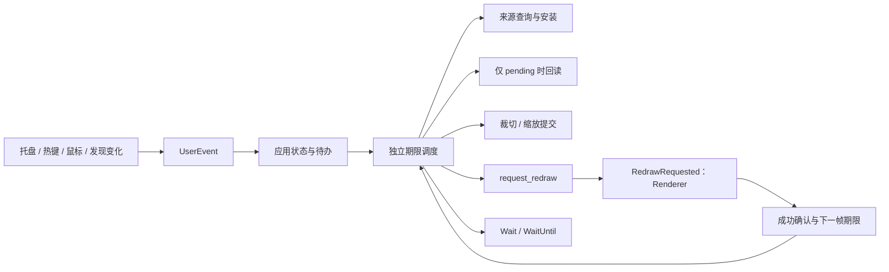

# Performance baseline and resource model

最新实测见 [2026-10-11 性能测试结果](Knowledge/2026-10-11-performance-results.md)：
包含四轮 Release CPU/GPU/事件测量，以及已有 720p 接收端的只读现场采样。
当前重构后的模块结构见 [模块契约与维护指南](ARCHITECTURE.md)。下文带日期的结构表保留历史路径。

This document records the baseline observed before the source-resolution rendering and Alpha
readback work, plus the expected resource model after it. `N = width * height` pixels and `k` is
the window scale relative to the sender.

## Verification baseline

- `cargo test`: 18 tests passed.
- `cargo clippy --all-targets --all-features -- -D warnings`: passed.
- `cargo build --release`: passed.
- The only toolchain message was Cargo being unable to canonicalize the parent user-profile path;
  it was not a compiler, dependency, or Clippy warning.

## GPU memory

Before this change, the application-owned display and Alpha resources were approximately:

```text
2 BGRA swapchain buffers + 3 BGRA staging textures
= (2 * 4 + 3 * 4) * k^2 * N
= 20 * k^2 * N bytes
```

After this change, the swapchain remains at sender resolution and Alpha uses one R8 render target
plus two R8 staging textures:

```text
2 BGRA swapchain buffers + 1 R8 target + 2 R8 staging textures
= (2 * 4 + 1 + 2) * N
= 11 * N bytes while interaction or automatic crop needs Alpha
```

When both interaction and automatic crop are disabled, the R8 resources are released, leaving approximately `8 * N`
bytes. These formulas exclude the sender-owned shared texture, driver alignment, and compositor
surfaces.

| Sender size | Old at 1x | New, Alpha needed | New, both features off |
| --- | ---: | ---: | ---: |
| 1920x1080 | 39.55 MiB | 21.75 MiB | 15.82 MiB |
| 3840x2160 | 158.20 MiB | 87.01 MiB | 63.28 MiB |

At 2x display scale, the old 1080p resource model grew to about 158.20 MiB; the new model remains
21.75 MiB because only the DirectComposition transform and window size change.

Automatic crop is enabled by default as of 2026-10-11. It shares the same R8 target and staging
textures with interaction; it does not create a second readback pipeline. The cropped window
does not shrink the source-resolution swapchain or the sender-owned texture. The formula above
excludes CPU Alpha buffers and transient references retained by the graphics context.

Considering Alpha resources alone, storage drops from `12 * N` to `3 * N` bytes (75%):

| Sender size | Old Alpha resources | New Alpha resources |
| --- | ---: | ---: |
| 1920x1080 | 23.73 MiB | 5.93 MiB |
| 3840x2160 | 94.92 MiB | 23.73 MiB |

## Readback and rendering bandwidth

The CPU-visible Alpha transfer per sample drops from BGRA `4 * N` to R8 `N` bytes. At the current
10 Hz Alpha update interval, the nominal staging/readback traffic changes as follows:

| Sender size | Old | New |
| --- | ---: | ---: |
| 1920x1080 | 79.10 MiB/s | 19.78 MiB/s |
| 3840x2160 | 316.41 MiB/s | 79.10 MiB/s |

The R8 path adds a source-resolution pixel-shader pass, so total GPU traffic also includes reading
the source and writing the R8 target. The table intentionally reports only the staging/readback
portion with an unambiguous format-size reduction.

Application Draw work now stays at `N` pixels rather than `k^2 * N`; DirectComposition performs
the final display scaling. When the Spout frame-count semaphore is active, Draw/Present frequency
is bounded by new sender frames (plus explicit redraws). Senders that leave the count at zero keep
the previous receiver-paced behavior.

## 本轮结构检查与优化（2026-10-10）

项目采用 Rust + Win32 + D3D11 + DirectComposition，模块职责如下：

| 模块 | 职责 |
| --- | --- |
| `src/main.rs` | 程序入口、日志和错误退出 |
| `src/app.rs` | 初始化、事件循环、Sender 资源重建、渲染与呈现 |
| `src/config.rs` | 帧率设置和唤醒调度 |
| `src/spout.rs` | 共享内存协议、Sender 发现、元数据与帧计数 |
| `src/dx/` | 设备、着色器、交换链、合成、纹理同步、Alpha 回读 |
| `src/interaction/` | 快捷键、拖动缩放、鼠标钩子和透明度命中检测 |
| `src/tray.rs` | 独立托盘线程、菜单状态和操作传递 |

现有的源分辨率渲染、R8 回读和后台 Sender 发现已经降低了主要资源开销。
本轮针对仍然存在的空转与重复操作进行了以下修改：

| 环节 | 原行为 | 优化后 |
| --- | --- | --- |
| Sender 帧计数不变 | 每 1 ms 重试 | 按 1、2、4、8 ms 退避，最大 8 ms |
| Sender 纹理锁忙 | 每 1 ms 重试 | 保持 1 ms 重试，避免把锁争用当成静止画面 |
| 全屏绘制 | 清空整个目标后再覆盖所有像素 | 直接覆盖，包括 Alpha 为零的像素 |
| Alpha 回读 | 有绘制时，同一轮循环可能尝试两次 `Map` | 每轮只读一次，提取任务单独入队 |
| Alpha 目标资源 | 每次提取调用 `GetResource` | 创建时缓存资源接口 |
| Sender 名称 | 每轮事件循环复制当前名称 | 借用名称，仅在切换或重建时复制 |
| Sender 元数据 | 为 280 字节数据分配临时 `Vec` | 使用固定栈缓冲区 |
| 自动选择来源 | 遍历前复制整个来源列表 | 借用列表，仅复制选中的来源 |

稳定退避时的名义定时轮询预算由约 1000 次/秒降至 125 次/秒，减少 87.5%。
这是调度模型的计算结果，并非实测 CPU 占用降幅；Windows 定时器、输入事件和锁争用
都会影响实际唤醒次数。Sender 新帧呈现、显式重绘、帧率调整或进入隐藏状态会重置退避。
无帧计数的 Sender 保留持续接收方式。本节记录 2026-10-10 的行为；隐藏或无 Sender 时的
定时等待已由下文 2026-10-11 的事件调度替换。

取舍是：帧计数 Sender 在两帧之间或静止后恢复更新时，轮询可能引入最多 8 ms 的
名义等待。资源尺寸和 Alpha 采样频率保持原值，本轮没有进一步降低显存尺寸模型。
移除清屏省去一次全目标清除调用；驱动可能使用快速清除，不能将逻辑像素字节数直接
等同于实测显存带宽节省。

验证结果：

- 修改前：25 项单元测试通过。
- 修改后：29 项常规测试通过；新增退避上限、锁争用、重置、限帧和隐藏调度验证。
- 单独运行 1 项 D3D11 测试通过：对 17×9 的奇数尺寸纹理逐像素检查预乘颜色、透明
  像素和边缘覆盖，并验证 R8 回读数据、双缓冲队列满载和复用。
- 格式检查、严格 Clippy 检查和 Release 构建通过。

D3D11 测试默认忽略，可在 Windows 上使用 `cargo test --locked -- --ignored` 执行。
本次未连接真实 Spout Sender 做端到端 FPS、CPU/GPU 占用和输入延迟对比，因此没有
宣称实际帧率提升百分比。

后续性能采样应覆盖静止帧、30/60/120 FPS、1080p/4K、交互开关和隐藏窗口。
`Present(1, ...)` 仍使用垂直同步，限帧等待与呈现等待的叠加需要结合实际刷新率采样；
不能仅凭菜单中的 “Unlimited” 或 “120 FPS” 判断真实呈现速度。
对应 API 语义见微软的 [Present 文档](https://learn.microsoft.com/en-us/windows/win32/api/dxgi/nf-dxgi-idxgiswapchain-present)
和 [非阻塞 Map 标志文档](https://learn.microsoft.com/en-us/windows/win32/api/d3d11/ne-d3d11-d3d11_map_flag)。

## 稳定自动裁切（2026-10-11）

新增 `src/crop.rs`，集中管理可见范围、8 像素边距、500 ms 收缩延迟、像素对齐布局和命中坐标变换。
复用已有 R8 回读结果，以逐行首尾非零 Alpha 找到外接矩形；未开启交互时复用同一个 CPU 缓冲区。
裁切只更新 DComp 偏移与窗体位置/尺寸，不因边界动画反复重建交换链。
静止 Sender 的首次样本也可以在延迟到期后完成裁切，不要求 Sender 再发送一帧。

默认启用自动裁切会使非交互模式也需要 R8 提取与回读，因此会增加此前纯显示模式的开销。
本轮没有宣称显存随裁切面积减少。后续可用 GPU 外接矩形归约替代非交互模式的全图 Alpha 回读，
但仍需在整个源纹理范围检测新内容，不能只检测已裁切区域。

裁切布局使用同一个像素对齐偏移进行窗口位置补偿、DComp 变换和 Alpha 命中检测。
按微软文档，视觉偏移先于缩放，因此设置的视觉偏移为负的物理偏移除以缩放倍数。
资源代次纳入就绪判断；keyed mutex 使用原始 HRESULT，只在精确 S_OK 时创建持锁 guard。

验证：36 项测试（包含 3 项显式启用的 Windows/D3D11 测试）通过，严格 Clippy 检查通过。
覆盖透明/微弱 Alpha 边缘、稳定延迟、即时扩大、空白帧、负屏幕坐标、非整数缩放、
裁切后的原始纹理命中坐标，以及真实隐藏 HWND 的裁切、缩放和完整画布恢复。
隐藏 HWND 测试实际调用 DComp Commit 和 SetWindowPos，未连接真实 Sender 检验动画的桌面合成表现。

## 裁切新增开销实测与预算（2026-10-11）

本机 CPU 为 Intel Core Ultra 5 225H，显示适配器为 Intel Arc 130T。
使用 `rustc -O` 编译独立探针，直接调用当前 `visible_bounds`；每种图案预热 10 次，
进行 5 组各 50 次检测，以下为组均值的中位数。仅测 CPU 范围检测，未包含 Alpha 提取、
GPU/CPU 回读、窗口调整、Present 或真实 Sender 调度。

| 源尺寸 | 全不透明 | 全透明 | 中心矩形，宽高各为源的 1/4 |
| --- | ---: | ---: | ---: |
| 1920×1080 | 0.0012 ms/次 | 0.5032 ms/次 | 0.4553 ms/次 |
| 3840×2160 | 0.0041 ms/次 | 1.7650 ms/次 | 1.8139 ms/次 |

全不透明时每行首尾很快命中；大片透明时需要遍历更多字节，因此两类输入开销不同。
按 10 Hz 折算，中心矩形检测约使用 4.6 ms/s（1080p）和 18.1 ms/s（4K）的运行时间，
约相当于一个核心时间预算的 0.46% 和 1.81%。这些不是任务管理器中整个进程的 CPU 占用测量。
探针位于忽略的 `target/crop_cost_probe.rs`，数据为合成掩码微基准，不代表所有实际动画负载。

相对于关闭交互且关闭裁切的纯显示路径，单独开启裁切的名义新增资源为：

| 源尺寸 | R8 GPU 资源（一个目标、两个 staging） | CPU Alpha 缓冲 | 10 Hz 回读字节预算 |
| --- | ---: | ---: | ---: |
| 1920×1080 | 5.93 MiB | 约 1.98 MiB | 19.78 MiB/s |
| 3840×2160 | 23.73 MiB | 约 7.91 MiB | 79.10 MiB/s |

GPU 驱动对齐、延迟释放、合成器资源和 GPU Alpha pass 的源读取/写入不在这些数字内。
交互已开启时，裁切共享同一组回读资源，主要新增边界扫描和布局变更，不再额外分配第二组 GPU 纹理。
来源提供有效帧计数且静止时，首次检测后不重复提取 Alpha；不支持帧计数的兼容来源仍可能持续采样。

布局只在裁切矩形或缩放变化时调用 DComp Commit/SetWindowPos；稳定矩形不会每帧调整窗口。
窗口缩小可能减少桌面合成工作，但当前全尺寸 Draw、交换链和共享源纹理没有随之缩小，
未测得可据此宣称的净 GPU 性能收益。下一步优先评估非交互模式下 GPU 归约外接矩形，
只回读几个边界整数，以减少大纹理的全图传输；归约本身仍必须覆盖整个源图像。

## 事件与独立期限架构实施（2026-10-11）

本轮保留主线程、发现线程、托盘线程和鼠标钩子线程，没有引入新的异步运行时或独立渲染线程。

| 模块 | 所有权与职责 |
| --- | --- |
| `events.rs` | AppAction/AppEvent；后台线程通过 winit EventLoopProxy 发布消息 |
| `app.rs` | ApplicationHandler、窗口、DComp、用户状态、事件处理和跨模块编排 |
| `renderer.rs` | 设备/Immediate Context、已安装身份、交换链、Draw/Present、Alpha 和裁切状态 |
| `source.rs` | SourceController；元数据、完整身份匹配、按资源代次隔离的重建重试 |
| `scheduler.rs` | 来源、帧、回读、布局、Alpha 初始化的独立期限 |
| `diagnostics.rs` | Debug 位图、像素采样和窗口样式诊断；Release 不编译此模块 |



主要改变：

- 热键不再使用单个 AtomicBool 标志；托盘动作不再拆成命令编号与来源名称两个槽位。
  每个动作带完整参数进入事件循环，重复 Toggle 和来源选择保持发送顺序。
- 鼠标穿透由钩子直接发布 UserEvent，主线程接收主动通知；发布失败时不继续吞掉该事件。
- 发现线程仅在名单或错误状态变化时发布快照通知，正常名单不变时保持安静。
  新发现结果使断连查询立即到期，取消旧的 500 ms 等待。
- AboutToWait 执行最多一轮各类到期维护任务并计算最早期限；Draw/Present 只在 RedrawRequested 中执行。
  多次绘制请求用 redraw_queued 合并，用户动作保持逐个处理。
- 无来源且没有重试/尾部任务时，UI 使用 Wait；后台发现仍每约 500 ms 扫描。
  隐藏窗口取消帧、回读和布局任务；已连接来源的元数据监控保留约 100 ms 周期。
- 帧率计时记录实际绘制起点，Draw/Present 耗时消耗当前帧预算；逾期后安排后续尝试，不追赶式连发旧帧。
  Unlimited 在成功呈现后安排下一次绘制，锁忙维持短重试，帧计数不变维持 1/2/4/8 ms 退避。
- pending_frame 在锁忙时保留，成功 Present 后清除；帧计数仍在同步访问范围内查询，避免提前消耗新帧信息。
- 新资源先 prepare，DComp 内容安装和窗口布局成功后再 install 身份；失败恢复原内容并按身份重试。
  绘制入口也校验缓存的完整来源身份，阻止选择/发现事件后读取旧资源。
- Alpha 仅在存在 pending 槽位时安排约 2 ms 间隔的非阻塞检查；更换来源和切换交互会取消旧任务。
  槽位携带交互会话代次，旧会话结果不能发布成当前鼠标掩码。
- Alpha 创建失败按 500 ms 冷却重试；两项功能都关闭时，即使窗口隐藏也会释放应用持有的回读资源并解绑。
  禁用交互会清理钩子当前掩码和邮箱 CPU 缓冲。

45 项测试全部通过，其中 5 项为显式运行的 Windows/图形平台测试。
新验证包括真实事件循环的重复动作顺序、独立期限消费、无来源 UI 无轮询期限、发现后立即查询、
来源消失时的身份失效、代次隔离重试，以及真实共享 keyed texture 的锁忙重试和过期 Alpha 会话拒绝。
严格 Clippy、格式检查和 Release 构建通过。

本轮没有测量真实 Sender 的端到端性能百分比；边界扫描微基准仍只代表该 CPU 函数。
Present 仍在主线程执行，事件通知不能中断正在发生的呈现等待。若采样显示它拖慢输入，
下一阶段再评估将整个 Immediate Context/Draw/Map/Present 所有权移入 RenderWorker。
命名纹理锁的跨设备 GPU 提交时序和真实输入转发语义仍需专项验证。
